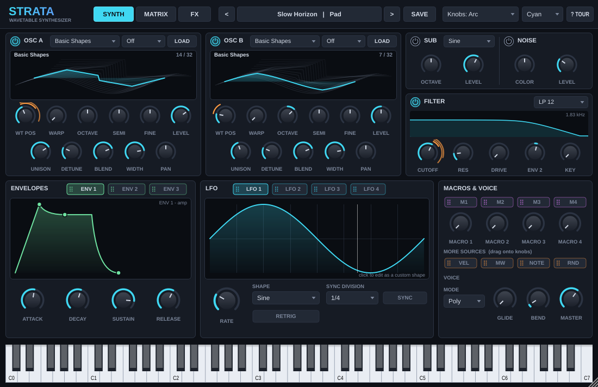
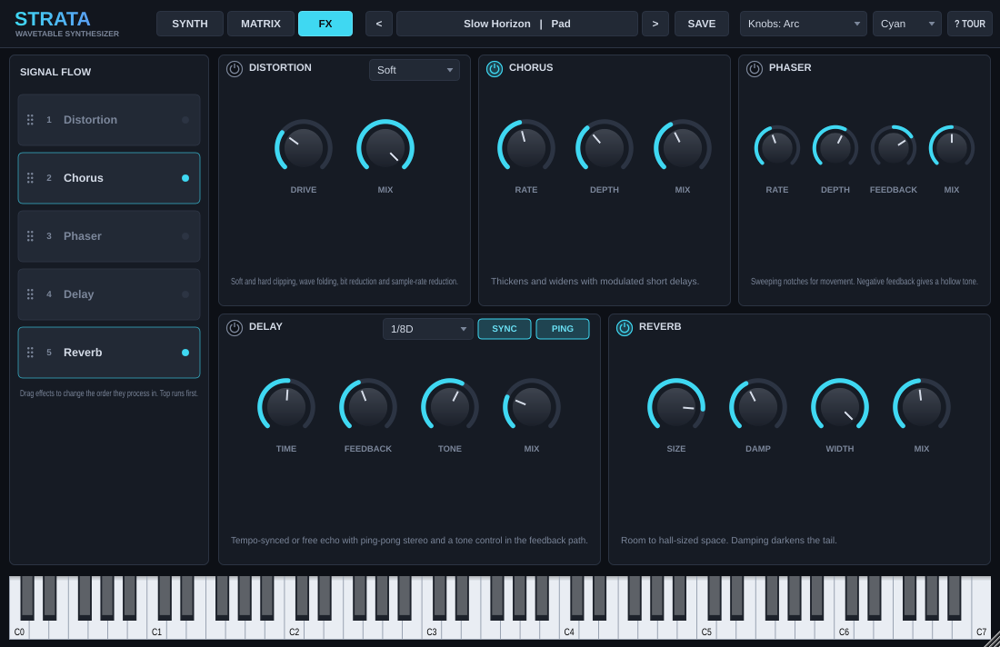
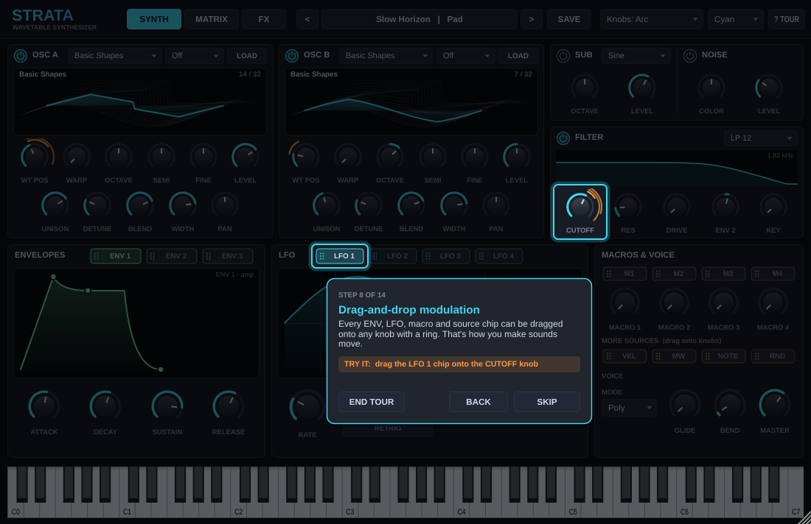
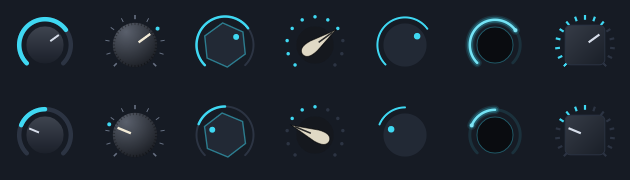

# Strata: wavetable synthesizer (VST3 / Standalone)

A JUCE 8 / C++20 wavetable synth with drag-and-drop modulation, seven knob shapes,
127 factory presets, user presets, custom wavetable import and an interactive in-app tour.

## Features

**Sound engine**
- 2 wavetable oscillators, 12 built-in banks (Basic Shapes, PWM, Harmonic Sweep, Formant, FM Metal,
  Sync Sweep, Growl, Digital, Organ, Spectral, Saw Fold, Pluck Spectra), 32 frames each, band-limited
  with 11 mip levels so high notes don't alias
- Load your own wavetables: `.wav` / `.aif` / `.flac`. Single cycles, 256/512/1024/2048/4096-sample frame
  tables (the common "Serum-style" format) and ordinary samples (sliced into frames). User tables are
  embedded in presets and DAW sessions, so they travel with the project.
- Up to 8-voice unison per oscillator with detune, blend and stereo width
- Warp modes: Sync, Bend, PWM, Mirror, Fold, Crush
- Sub oscillator (sine / triangle / square) and coloured noise
- Filter: LP12, LP24, HP12, HP24, Band, Notch, with drive, envelope amount and key tracking
- 3 envelopes, 4 LFOs (8 shapes including a drawable custom shape, tempo sync, retrigger / free-run),
  4 macros, velocity, mod wheel, note and random sources
- 16-slot modulation matrix; 27 modulatable destinations; per-voice modulation
- Poly (16 voices), Mono and Legato modes with glide; sustain pedal and pitch bend
- Effects rack you can reorder by dragging: Distortion (5 types), Chorus, Phaser, Delay (sync, ping-pong,
  tone) and Reverb

**Interface**
- Drag any ENV / LFO / macro / source chip onto a knob to modulate it. An orange ring shows the depth, and
  a white dot shows the live modulated value while notes play.
- Alt-drag a knob to change modulation depth. Right-click a knob for depth presets, invert, remove,
  "add modulation from", reset, or a per-knob shape.
- 7 knob shapes (Arc, Vintage, Hex, Chicken Head, Minimal, Neon, Square), set globally from the top bar or
  per knob; 5 accent colours. These are saved as preferences, not in presets.
- Movable editors: drag the wavetable display to morph, drag envelope handles, draw LFO points
  (double-click to add or remove, Shift to snap)
- Preset browser with categories, search and click-to-audition; save your own presets
- Interactive tour (14 steps) that highlights live controls and advances when you complete each action.
  It runs on first launch; replay it with **? TOUR**.
- Resizable window (70% to 150%), on-screen keyboard (computer keys A W S E D... play notes in the standalone)

## Building on Windows

Requirements: Visual Studio 2022 (Desktop development with C++), CMake 3.22+, Git.
JUCE 8.0.4 is downloaded automatically on first configure.

```bat
cmake -B build -A x64
cmake --build build --config Release --target Strata_VST3 Strata_Standalone
```

Outputs:
- `build\Strata_artefacts\Release\VST3\Strata.vst3` → copy into `C:\Program Files\Common Files\VST3\`
  and rescan in your DAW
- `build\Strata_artefacts\Release\Standalone\Strata.exe` → runs on its own, handy for testing

To have CMake copy the plug-in into the VST3 folder automatically, set `COPY_PLUGIN_AFTER_BUILD TRUE` in
`CMakeLists.txt` (needs an elevated prompt the first time).

To use a local JUCE checkout instead of downloading: `cmake -B build -DJUCE_PATH=C:/path/to/JUCE`.

### Build in the cloud instead
`.github/workflows/build-windows.yml` builds the VST3 and standalone on GitHub's Windows runners. Push the
project to a GitHub repo and download the zipped plug-in from the workflow run's **Artifacts**.

## Offline test

```bat
cmake -B build -DSTRATA_BUILD_TESTS=ON
cmake --build build --config Release --target StrataTest
build\StrataTest_artefacts\Release\StrataTest.exe  snapshots_folder
```

It checks every wavetable bank, renders every factory preset (reports silence, NaN and level), tests
wavetable import plus state save/restore, and writes PNG snapshots of each page and the tour.
On the reference machine all 127 presets pass and the engine renders at roughly 100x realtime on one core.

## Where things are saved
- User presets: `Documents\Strata\User Presets\*.strata` (XML). Share them by copying the files.
- UI preferences (knob shape, accent, tour seen): `%APPDATA%\Strata\Strata.settings`

## Project layout

| File | What it does |
|---|---|
| `Source/Parameters.*` | All parameter IDs, ranges, choice lists, modulation sources and destinations |
| `Source/Wavetable.*` | Wavetable storage, mip-mapping, the 12 factory banks, WAV import |
| `Source/Engine.*` | Voices, envelopes, LFOs, modulation, oscillators, filter, voice allocation |
| `Source/Effects.*` | Reorderable FX chain |
| `Source/PluginProcessor.*` | Processor, state (mods, LFO curves, FX order, user tables), UI settings |
| `Source/Presets.*`, `FactoryPresets.cpp` | Preset manager and the 127 factory presets |
| `Source/UI/LookAndFeel.*` | Colours and the 7 knob shapes |
| `Source/UI/Controls.*` | Mod-aware knob, source chips, panels |
| `Source/UI/Editors.*` | Wavetable display, envelope and LFO editors |
| `Source/UI/Pages.*` | Synth, Matrix and FX pages |
| `Source/UI/PresetBrowser.*` | Preset bar and browser |
| `Source/UI/Tutorial.*` | Interactive tour overlay (steps are defined in `PluginEditor.cpp`) |

## Extending it
- **Add a factory preset:** add an entry to a category in `FactoryPresets.cpp` (name, wavetable banks,
  flavour), or write a new category recipe. Presets are built from code, so they never go missing.
- **Add a wavetable bank:** add its name to `bankChoices()` in `Parameters.cpp` (before `"User"`) and a
  `case` in `buildBank()` in `Wavetable.cpp`.
- **Add a knob shape:** add a name to `knobStyleNames()`, an enum value, and a `case` in
  `StrataLook::drawKnob()`.
- **Add a modulation destination:** add the parameter ID to `mod::destIDs()` and its name to `destName()`,
  then read it through `actual()` in `Voice::render()`. Keep the index order in sync with the `Dest` enum
  in `Engine.cpp`.
- **Edit the tour:** `MainContent::buildTutorial()` in `PluginEditor.cpp`. Each step has a title, text,
  optional "try it" prompt, the components to highlight, and an optional completion check.

## Before you sell or distribute it
- JUCE is dual-licensed (AGPLv3 or a commercial JUCE licence). Closed-source commercial releases need a
  JUCE licence that fits your revenue; check juce.com for the current terms.
- Check Steinberg's current VST3 SDK licence terms and the "VST" trademark guidelines.
- The look is original; keep it that way rather than copying another product's artwork or names.
- Change `COMPANY_NAME`, `BUNDLE_ID`, `PLUGIN_MANUFACTURER_CODE` and `PLUGIN_CODE` in `CMakeLists.txt` to
  your own unique values before release (the codes identify the plug-in to hosts).
- Code-sign the binaries and run them through pluginval (https://github.com/Tracktion/pluginval).

## Screenshots





